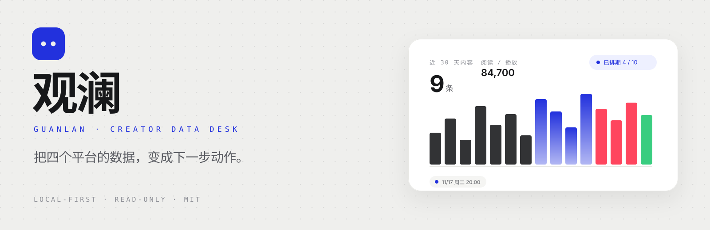
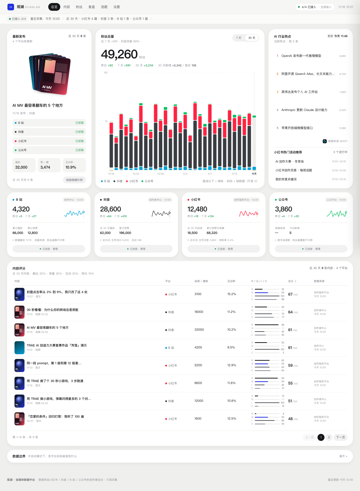
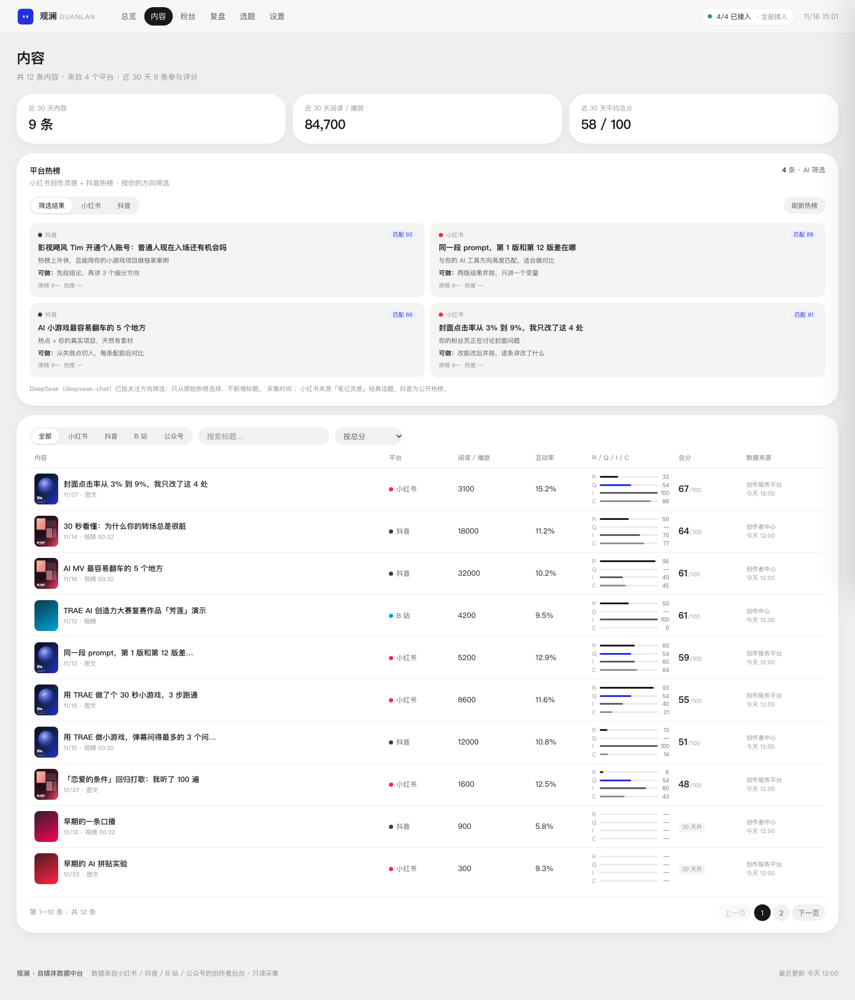
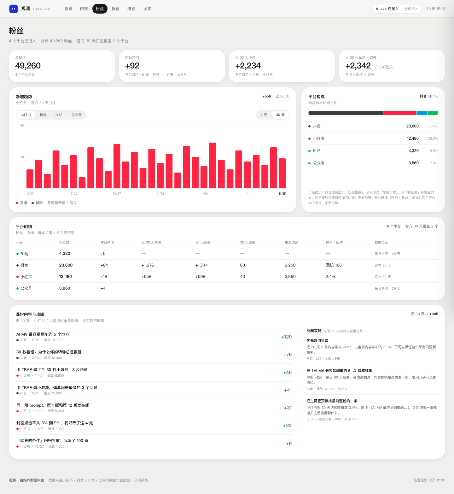
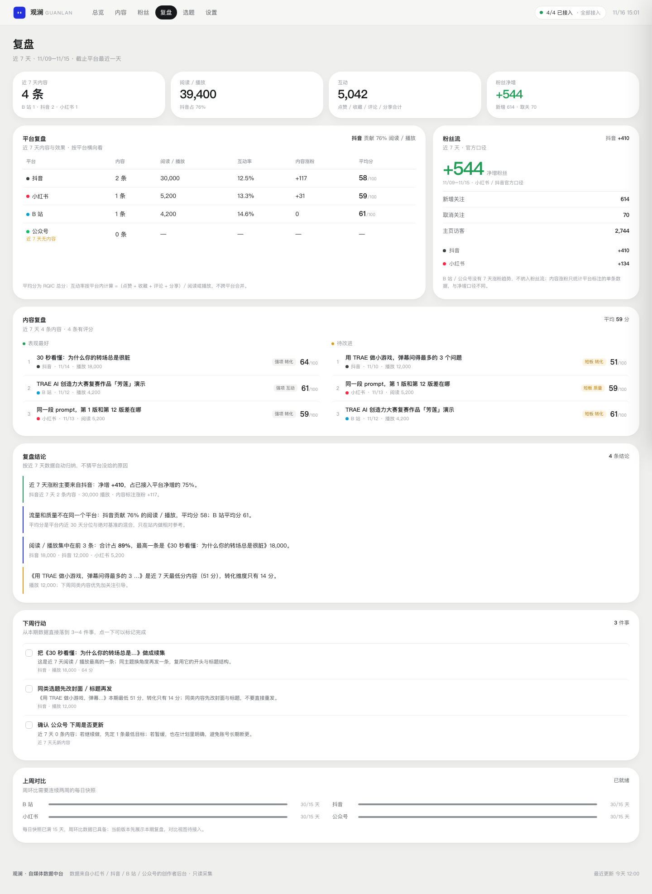
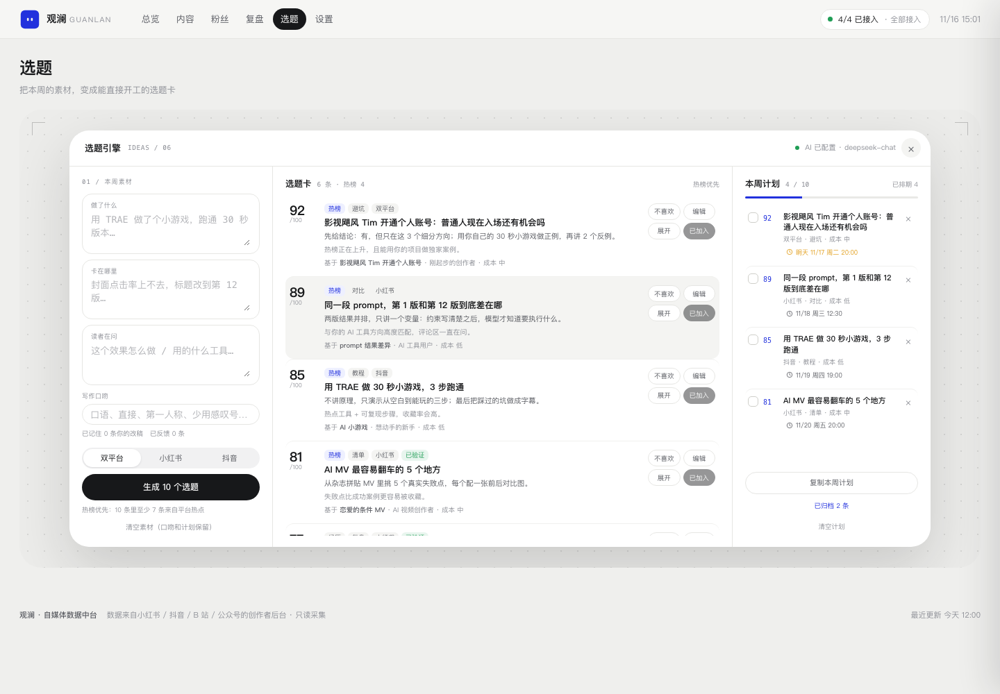
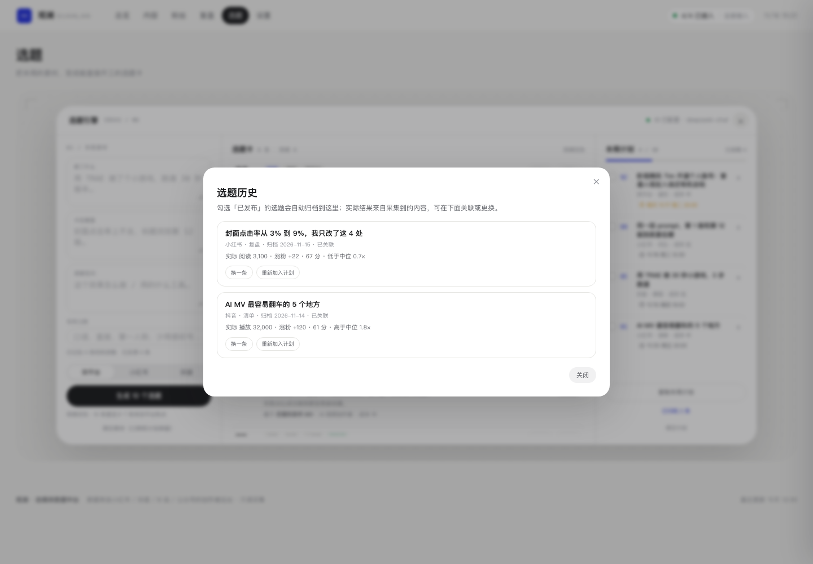
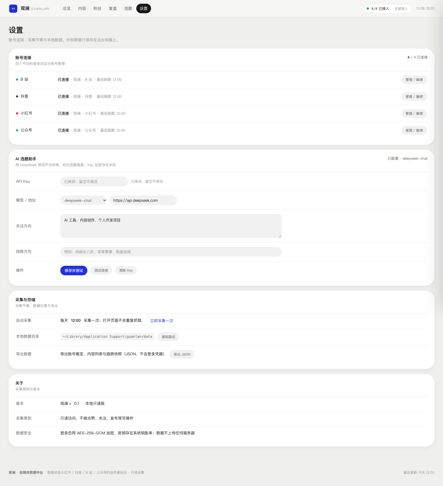
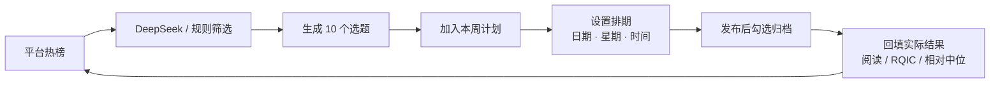
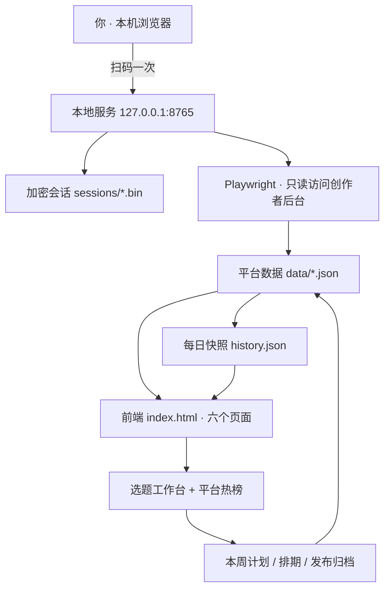

<p align="center">
  
</p>

<p align="center">
  
</p>

<p align="center">
  <b>扫码接入</b> · <b>近 30 天统一口径</b> · <b>RQIC 内容评分</b> · <b>选题发布闭环</b> · <b>数据只留本机</b>
</p>

<p align="center">
  <a href="#看界面">看界面</a> ·
  <a href="#能做什么">能做什么</a> ·
  <a href="#核心机制">核心机制</a> ·
  <a href="#快速开始">快速开始</a> ·
  <a href="#采集与数据源">采集与数据源</a> ·
  <a href="#接口">接口</a> ·
  <a href="#测试">测试</a> ·
  <a href="#项目结构">项目结构</a>
</p>

> **一句话**：观澜把你自己的小红书、抖音、B 站、公众号创作者后台，收进一张本地数据台——看数据、做复盘、定选题、排发布，全在一个页面里完成。

---

## 为什么是观澜

多平台创作者最常见的三个问题：

1. **数据散**：四个后台四个口径，粉丝、阅读、互动各算各的，拼不出一张完整账。
2. **看完不知道做什么**：知道某条内容表现差，但不知道下一条该改什么。
3. **选题靠拍脑袋**：热点、账号方向、上周复盘结果，三件事各在各的地方。

观澜把这三件事串成一条线：

```
采集 → 统一口径 → RQIC 评分 → 复盘结论 → 热榜选题 → 本周计划 → 发布归档 → 结果回填
```

它不是又一个数据看板，而是一张**能落到动作**的工作台。

---

## 看界面

> 下列截图使用演示数据生成，不含任何真实账号信息。

<p align="center">
  
  <br />
  <sub><b>总览</b>：四平台 KPI、近 30 天粉丝堆叠柱、AI 行业热点、小红书活动、内容评分一览。</sub>
</p>

### 六个页面，一条工作流

<table>
  <tr>
    <td width="50%" valign="top">
      
      <br />
      <sub><b>内容</b>：全部内容列表；近 30 天内容参与 RQIC 评分，平台热榜按关注方向筛选。</sub>
    </td>
    <td width="50%" valign="top">
      
      <br />
      <sub><b>粉丝</b>：7 天 / 30 天切换，净增趋势、涨粉来源、平台明细与涨粉攻略。</sub>
    </td>
  </tr>
  <tr>
    <td width="50%" valign="top">
      
      <br />
      <sub><b>复盘</b>：近 7 天、只算已接入平台；平台复盘 + 内容 Top / Bottom + 结论与下周行动。</sub>
    </td>
    <td width="50%" valign="top">
      
      <br />
      <sub><b>选题</b>：液态画布三栏——本周素材、选题卡、本周计划；最多 10 条，可逐条排期。</sub>
    </td>
  </tr>
  <tr>
    <td width="50%" valign="top">
      
      <br />
      <sub><b>选题历史</b>：归档时回填真实结果，自动对比平台中位，形成下一轮选题的反馈。</sub>
    </td>
    <td width="50%" valign="top">
      
      <br />
      <sub><b>设置</b>：四平台连接状态、DeepSeek 配置、数据目录、JSON 导出与版本信息。</sub>
    </td>
  </tr>
</table>

---

## 能做什么

| 模块 | 能做什么 | 关键细节 |
|---|---|---|
| **总览** | 四平台粉丝 / 阅读 / 互动一屏总览 | 近 30 天统一口径；缺数据画斜纹，不画 0 |
| **内容** | 看全部内容、封面、互动与 RQIC 四分项 | 近 30 天内容参与评分，超出窗口只展示不评分 |
| **内容详情** | 单条内容 RQIC 拆解 + 优化建议 | 按最弱维度给 2–3 条具体动作 |
| **平台热榜** | 小红书创作灵感 + 抖音热榜 | 按关注方向筛选；配 DeepSeek 后由模型挑，只能选不能编 |
| **粉丝** | 7 / 30 天趋势、净增、新增、取关、主页访客 | 只合并已接入平台；涨粉攻略从近 30 天涨粉内容提炼 |
| **复盘** | 平台复盘、内容 Top / Bottom、复盘结论 | 近 7 天；只算已接入平台；结论可勾选成下周行动 |
| **选题** | 三句话素材生成 10 个选题 | 热榜优先，10 条里至少 7 条来自平台热点 |
| **本周计划** | 最多 10 条，勾选 / 拖拽入计划 | 支持日期、星期、时间排期；复制计划会带排期 |
| **发布归档** | 勾选“已发布”后回填实际结果 | 阅读 / 播放、RQIC 分、相对平台中位；同一选题只保留一条历史 |
| **选题历史** | 查看归档、重新加入计划 | 重新加入会标记 `reopened`，再次归档不重复 |
| **AI 选题助手** | DeepSeek 筛选热榜、生成选题、展开选题 | Key 加密存本机，接口只回传“是否已配置” |
| **设置** | 连接 / 断开四平台、导出数据 | 导出 JSON 不含登录凭证 |

---

## 核心机制

### 1. 统一口径：内容只看近 30 天

四个平台后台的默认时间窗口并不一致，直接合并会得到互相矛盾的数字。观澜在采集端和前端同时收口：

- 采集窗口：`CONTENT_DAYS = 30`，只取近 30 天发布的内容
- 内容页保留全部内容，但**超出 30 天的条目不参与评分**，并用角标说明原因
- 首页“最新发布”、内容评分、顶部说明条使用同一个窗口
- 复盘页单独使用**近 7 天**，且只统计已接入平台

> 为什么不用“本周一到今天”：周一当天窗口为空，会把已发布内容全部滤掉。

### 2. RQIC：四个维度，平台内比较

| 维度 | 含义 | 数据 |
|---|---|---|
| **R** 触达 | 内容能不能被看到 | 播放 / 阅读 |
| **Q** 质量 | 看到之后留不留得住 | 点击率 / 完播率 |
| **I** 互动 | 有没有反应 | 点赞 + 1.5×收藏 + 2×评论 + 1.5×分享，再除以阅读 |
| **C** 转化 | 有没有带来关注 | 涨粉 / 阅读 |

综合分权重：触达 25%、质量 30%、互动 30%、转化 15%。

每一维混合两种口径：

- **平台内百分位**：只和同平台近 30 天内容比，避免跨平台口径不可比
- **绝对基准**：阅读中位数 = 50 分，其余按固定阈值
- 综合 = 分位 × 0.6 + 绝对 × 0.4；平台内少于 3 条时只用绝对分

### 3. 选题发布闭环

这是观澜和普通看板最大的区别：



闭环里的几个约束：

- 本周计划最多 **10 条**，避免计划膨胀
- 每条计划可设置排期，过期未发会用状态色提示
- 归档记录按标题去重；同一选题重新加入计划后再归档，不会产生第二条历史
- 重新加入计划会清空旧排期、标记 `reopened`
- 改标题会同步历史记录，避免同一条内容出现两个名字
- “不喜欢”的理由会被记住，下一轮生成时作为负反馈传入

### 4. 热榜与 AI：只能选，不能编

平台热榜来自两处真实数据：

- **小红书**：创作服务平台「笔记灵感」页自己发出的 `/api/galaxy/creator/select/topic/detail`
- **抖音**：公开的 web 热榜接口，无需登录

筛选分两条路：

1. **已配置 DeepSeek**：把原始热榜、账号关注方向、近期内容标题一起给模型，要求它只能从原始榜单里挑，不能新增标题
2. **未配置 / 调用失败**：按关注词做规则筛选，保证页面仍然可用

AI 调用失败不会让页面空白，而是退回规则筛选并标明原因。

### 5. 本地优先与只读边界

- 服务只监听 `127.0.0.1`，不对公网暴露
- 登录态用 **AES-256-GCM** 加密；macOS 主密钥存系统钥匙串，其它系统退回 0600 权限的密钥文件
- DeepSeek API Key 使用同一套加密写入 `config/ai.bin`，`/api/settings` 只返回“是否已配置”
- 只读取页面已经渲染的数据或页面自己发出的请求，不逆向签名、不构造签名请求
- 不做点赞、关注、评论、发布等任何写操作
- 遇到滑块 / 人机验证立即停止，等用户处理

### 6. 每日快照与启动补采

- 每天 **12:00** 自动采集一次，一次产出账号概览、近 30 天内容、涨粉数据与每日快照
- 快照写入 `history.json`，同一天重复采集会覆盖，保留最近 **180 天**
- 服务启动时，如果最新数据已超过 **24 小时**没更新，会立刻补采一次，补上“12:00 时服务没开着”的空档
- 补采判断使用**最新文件时间**（`min` 年龄），只要有一个平台刚采过就不会反复全量采集

### 7. 数据流



数据只在本机流转：浏览器 ↔ 本地服务 ↔ 用户数据目录。没有云端账号，也没有数据上传接口。

---

## 快速开始

### 一键启动（推荐）

```bash
# 克隆项目（地址替换成你自己的仓库）
git clone <仓库地址> guanlan
cd guanlan

# 建虚拟环境、装依赖、下载 Chromium、启动服务并打开页面
./start.sh
```

脚本会自动完成：创建 `.venv` → 安装依赖 → 下载 Chromium（首次约 150MB）→ 启动服务 → 打开页面。重复执行会跳过已完成步骤。

国内网络较慢时可用镜像源：

```bash
# 使用清华 PyPI 镜像
PIP_INDEX_URL=https://pypi.tuna.tsinghua.edu.cn/simple ./start.sh
```

不想自动弹浏览器（例如跑在服务器上）：

```bash
# NO_OPEN=1 只启动服务，不开浏览器
NO_OPEN=1 ./start.sh
```

### 手动启动

```bash
cd guanlan

# 1. 创建独立环境，避免污染系统 Python
python3 -m venv .venv
source .venv/bin/activate          # Windows 用 .venv\Scripts\activate

# 2. 安装依赖
pip install -r requirements.txt

# 3. 下载浏览器内核（只需一次，约 150MB）
playwright install chromium

# 4. 启动本地服务，默认只监听 127.0.0.1:8765
python server/server.py
```

然后打开 <http://127.0.0.1:8765/>，点「连接账号」扫码授权。登录态加密保存在本机，后续自动复用。

### 环境要求

- Python **3.9+**
- macOS / Linux / Windows
- 首次运行需要网络下载 Chromium
- 单机单用户：数据目录、浏览器 profile、加密密钥都跟着当前系统用户走

---

## 数据放在哪

运行期数据**不放在项目目录**，按系统落在用户数据目录：

| 系统 | 路径 |
|---|---|
| macOS | `~/Library/Application Support/guanlan/` |
| Windows | `%APPDATA%\guanlan\` |
| Linux | `~/.local/share/guanlan/`（有 `XDG_DATA_HOME` 时优先）|

```text
guanlan/
├── data/
│   ├── xhs_creator.json        # 小红书：账号 + 近 30 天笔记 + 涨粉 + 活动
│   ├── douyin_creator.json     # 抖音：账号 + 近 30 天作品 + 涨粉
│   ├── bilibili_creator.json   # B 站：账号 + 近 30 天稿件
│   ├── bilibili_raw.json       # B 站页面接口原始响应（核对字段用）
│   ├── wechat_creator.json     # 公众号：账号 + 最近图文
│   ├── wechat_raw.json         # 公众号后台接口原始响应（核对字段用）
│   └── history.json            # 每日快照，同日覆盖，保留 180 天
├── sessions/                   # 加密后的登录态（AES-256-GCM）
├── browser-profile/            # Playwright 持久化浏览器配置
├── config/
│   └── ai.bin                  # DeepSeek 配置（加密）
└── master.key                  # 仅非 macOS 生成（0600）
```

明文 cookie 不落盘、不进日志、不回前端。换电脑或重装系统不会影响仓库内容。

---

## 采集与数据源

### 采集节奏

| 任务 | 时间 | 说明 |
|---|---|---|
| 全量采集 | 每天 **12:00** | 四平台依次采集，不并发抢浏览器 |
| 启动补采 | 服务启动时 | 最新数据超过 24 小时才补采 |
| 每日快照 | 每次采集后 | 写 `history.json`，同日覆盖，保留 180 天 |
| 平台热榜 | 30 分钟缓存 | 「刷新热榜」会立即重采 |
| AI 行业热点 | 10 分钟缓存 | 抓取失败退回上次结果并标记 `stale` |

几条运行规则：

- 12:00 正好卡在扫码流程里时，会等扫码结束（最多 5 分钟）再采，避免两个流程抢浏览器
- 登录态失效不硬闯，状态置为 `disconnected`，页面提示重新扫码
- 页面本身不轮询，采集完成后刷新浏览器才能看到新数字
- 已接入但近 30 天没有内容的平台会明确写“近 30 天无内容”，不会误读成没接好

### 数据源

| 平台 | 采集入口 | 拿到的数据 | 备注 |
|---|---|---|---|
| **小红书** | 创作服务平台：首页 / 数据分析 / 账号数据 / 笔记灵感 | 粉丝、获赞与收藏、近 30 天笔记、近 30 日涨粉、热门活动 | 需要登录态 |
| **抖音** | 创作者中心：首页 / 内容管理 / 数据中心 | 粉丝、作品、近 30 日粉丝 | 公开热榜无需登录 |
| **B 站** | 创作中心：首页 / 稿件管理 | 播放、粉丝、近 30 天稿件 | 30 天涨粉趋势暂用每日快照 |
| **公众号** | 公众平台：首页 / 发表记录 | 总用户数、今日新增、最近图文 | 单篇阅读在无头环境受限，暂不采集 |

涨粉数据的具体入口：

| 平台 | 页面 | 取数方式 |
|---|---|---|
| 小红书 | `creator.xiaohongshu.com/statistics/account/v2` | 被动监听页面自己发出的 `/api/galaxy/v2/creator/datacenter/account/base` |
| 抖音 | `creator.douyin.com/creator-micro/data-center/operation` | 同源调用页面自己的 `/janus/.../overview/dashboard/fans`，`recent_days=30` |
| B 站 | `member.bilibili.com/platform/home` | 被动监听 `/x/web/data/index/stat` 与 `/x/web/archives` |
| 公众号 | `mp.weixin.qq.com` | 首页读取总用户数 / 今日新增；`/cgi-bin/appmsgpublish` 取最近图文 |

平台按日汇总时，最后一天通常是“昨天”，所以图表今天那一格留空并画斜纹缺口，不伪造当天数字。

---

## 接口

本地服务提供以下 HTTP 接口，默认前缀 `http://127.0.0.1:8765`。

### 状态与数据

| 方法 | 路径 | 说明 |
|---|---|---|
| GET | `/api/xhs/state` | 小红书登录状态机快照 |
| GET | `/api/douyin/state` | 抖音登录状态机快照 |
| GET | `/api/bilibili/state` | B 站登录状态机快照 |
| GET | `/api/wechat/state` | 公众号登录状态机快照 |
| GET | `/api/xhs/data` | 小红书账号与内容数据 |
| GET | `/api/douyin/data` | 抖音账号与内容数据 |
| GET | `/api/bilibili/data` | B 站账号与内容数据 |
| GET | `/api/wechat/data` | 公众号账号与图文数据 |
| GET | `/api/history` | 每日快照历史（趋势图数据源） |
| GET | `/api/hot` | AI 行业热点前 5 条（AIHOT，10 分钟缓存） |
| GET | `/api/hotlists` | 平台热榜筛选结果（30 分钟缓存） |
| GET | `/api/settings` | 数据目录、采集节奏、AI 是否已配置 |

### 登录与采集

| 方法 | 路径 | 说明 |
|---|---|---|
| POST | `/api/xhs/connect` | 启动小红书扫码登录 |
| POST | `/api/douyin/connect` | 启动抖音扫码登录 |
| POST | `/api/bilibili/connect` | 启动 B 站扫码登录 |
| POST | `/api/wechat/connect` | 启动公众号扫码登录 |
| POST | `/api/xhs/disconnect` | 断开小红书 |
| POST | `/api/douyin/disconnect` | 断开抖音 |
| POST | `/api/bilibili/disconnect` | 断开 B 站 |
| POST | `/api/wechat/disconnect` | 断开公众号 |
| POST | `/api/refresh` | 手动触发一轮全量采集，立即返回 `{started}` |
| GET / POST | `/api/refresh/status` | 巡检是否还在跑 `{running}` |
| POST | `/api/hotlists/refresh` | 立即重采热榜（同步返回结果） |

### AI 与选题

| 方法 | 路径 | 说明 |
|---|---|---|
| POST | `/api/ideas/generate` | 根据素材、热榜、负反馈生成 10 个选题 |
| POST | `/api/ideas/expand` | 展开单条选题（切口 / 格式 / 成本） |
| POST | `/api/settings/ai` | 保存 DeepSeek 配置；`clearKey` 可清除 Key |
| POST | `/api/settings/ai/test` | 用当前配置发一条最小请求测试连通性 |

登录状态机共十态：

```text
disconnected / qr_loading / qr_ready / scanned / authorized
connected / expired / blocked / invalid / error
```

---

## 测试

项目包含 **60 条**自动化测试：前端 35 条（Playwright）+ 后端 25 条（`unittest`）。

```bash
# 一条命令跑全量
python3 tests/run_all.py

# 只跑后端
python3 -m unittest discover -s tests -p "test_backend.py" -v

# 只跑前端
python3 -m unittest discover -s tests -p "test_frontend.py" -v
```

测试策略：

- 前端用 `page.route('**/api/**')` mock 全部接口，**不需要真实账号**
- 后端使用临时数据目录，不读写你的真实数据
- 覆盖口径计算、RQIC、排期、计划上限、归档生命周期、历史去重、热榜降级、AI 配置加解密、启动补采边界、390px 响应式无溢出等
- 截图脚本与测试共用 `tests/fixtures.py` 的 mock 数据

---

## 项目结构

```text
guanlan/
├── index.html                  # 前端：单文件、零外部依赖、hash 路由
├── server/
│   └── server.py               # 本地服务：静态托管 + 扫码登录 + 采集 + 快照 + 热榜 + AI
├── tests/
│   ├── fixtures.py             # 测试与截图共用的 mock 数据 / 静态服务
│   ├── test_frontend.py        # 前端 35 条（Playwright）
│   ├── test_backend.py         # 后端 25 条（unittest）
│   └── run_all.py              # 全量测试入口
├── mockups/
│   ├── ideas-a.html            # 选题工作台早期方案
│   ├── ideas-c.html            # 品牌蓝来源方案
│   └── ideas-d.html
├── docs/
│   └── 需求与工程设计_v1.md      # 阶段一评审文档（需求、边界、设计规则）
├── assets/
│   ├── readme/                 # README banner 与徽章
│   ├── screenshots/            # 可公开的截图
│   │   ├── 04-brand/           # 标识方案
│   │   └── 05-readme/          # README 演示截图（演示数据）
│   └── samples/
│       └── xhs_creator.sample.json   # 采集结果字段样例（脱敏）
├── _local/                     # 本地个人素材（已 gitignore，不进入仓库）
├── requirements.txt            # playwright / cryptography
├── start.sh                    # 一键启动脚本
├── LICENSE                     # MIT
└── README.md
```

> 真实后台截图、第三方参考图和个人种子数据放在本地 `_local/`，已加入 `.gitignore`，不会随仓库分发。

前端是**单个 `index.html`**，没有构建步骤、没有 npm、没有打包产物。改完刷新即可看到效果。

---

## 设计规则（前端）

从参考站实测提取，全局只允许一套：

| 项 | 规则 |
|---|---|
| 底色 | `#efefed` 页面底 / `#ffffff` 卡片 / `#f4f4f2` 内嵌块 |
| 文字 | 主 `#17181a` / 次 `#5b5d63` / 辅助 `#8e9097` |
| 强调色 | 唯一强调蓝 `#2231dd` |
| 状态色 | 正向 `#1f9d55` / 负向 `#e5484d` / 待处理 `#e09a12` |
| 圆角 | 四档：`999 / 28 / 12 / 6`，不随意取值 |
| 阴影 | 卡片极淡双层阴影，弹层用更深一层 |
| 数字 | 全部 `tabular-nums`，避免刷新时列宽跳动 |
| 结论 | 每张卡右上角必须有“一句话结论” |
| 缺数据 | 画斜纹缺口，不画 0 |
| 平台色 | 只出现在圆点、图标、图例、单平台线 |

---

## 边界与免责声明

**这是一个只读的个人数据查看工具，不是爬虫框架。**

### 适合谁

- 同时运营 2–4 个平台，但不想每天开四个后台对数字的个人创作者
- 希望把“看数据 → 做复盘 → 定选题 → 排发布”放在一条线上完成的人
- 愿意在本机跑一个 Python 服务，能接受每个平台扫码登录一次的人
- 在意数据留在本机、不接受把账号数据交给第三方 SaaS 的人

### 不适合谁

- 需要多账号、团队协作、权限管理的团队（当前是单机单用户）
- 想要自动发布、自动点赞关注的人（本项目明确不做写操作）
- 想采集他人账号数据的人（只读取你自己的创作者后台）
- 完全不想碰命令行的人（目前没有打包成桌面 App）

### 做这些事

- 只读取你自己已登录的创作者后台页面，数据来自页面本身已经发出的请求
- 每天采集 1 次，低频访问
- 登录态与 AI Key 加密存在本机，不上传任何服务器
- 遇到滑块 / 人机验证立即停止，等你自己处理

### 不做这些事

- 不逆向平台签名算法，不伪造设备指纹，不破解验证码
- 不批量注册、不批量采集他人账号
- 不做任何写操作（点赞、关注、评论、发布）
- 不绕过登录墙、不抓取非本人有权访问的数据

### 风险提示

- 任何自动化访问都有可能被平台判定为异常，存在触发风控的可能，请自行评估并承担
- 请不要把本项目部署到公网，也不要多人共用同一个实例（它没有账号体系）
- 请自行遵守各平台的《用户协议》与相关法律法规，仅用于个人账号的数据查看

作者不对因使用本项目导致的账号异常、数据丢失或其它损失承担责任。

---

## 进度与后续

### 已完成

- [x] 阶段一：需求与工程设计（[文档](docs/需求与工程设计_v1.md)）
- [x] 首页可跑通（真实字段结构）
- [x] 小红书扫码接入端到端
- [x] 抖音创作者中心接入
- [x] B 站创作中心接入
- [x] 公众号扫码接入
- [x] 每日快照与历史趋势
- [x] RQIC 四维内容评分与单条优化建议
- [x] 粉丝页（7 / 30 天、涨粉来源、涨粉攻略）
- [x] 复盘页（平台复盘、内容 Top / Bottom、下周行动）
- [x] 选题工作台（10 个选题、热榜优先、DeepSeek 筛选与展开）
- [x] 本周计划 10 条 + 日期 / 星期 / 时间排期
- [x] 发布归档、实际结果回填、`reopened` 生命周期
- [x] 平台热榜 + AI 行业热点
- [x] 启动补采与 24 小时边界
- [x] 60 条自动化测试与 390px 响应式校验

### 待确认 / 后续

- [ ] 公众号单篇阅读数（等待后台「内容分析」页在无头环境可用）
- [ ] B 站 30 天涨粉趋势（接口确认后接入，目前用每日快照）
- [ ] 多账号与团队协作（当前定位为单机单用户）
- [ ] 内容日历导出与更多平台导出格式

---

## 许可证

[MIT](LICENSE)
